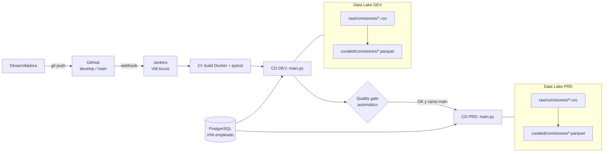

# Proyecto DataOps – Cálculo de comisiones (Python + Azure Data Lake + Jenkins)

Pipeline automatizado que combina la tabla `dmc.rrhh.empleado` (PostgreSQL) con el archivo `ComisionEmpleados_V1_<periodo>.csv` almacenado en Azure Data Lake. Hace el join por `empleado_id`, calcula `salario_total = salario + comisión` y publica una tabla consolidada en **Parquet** (y Excel) en el Data Lake. El despliegue es automático con **CI/CD en Jenkins**, disparado por cada `git push` a GitHub, y pasa por los entornos **DEV → PRD** con una aprobación automática por calidad de datos.

> El enunciado permite la variante "Script Python" + "GitHub" + "Jenkins". Este proyecto usa esa variante y reutiliza la infraestructura vista en clase: la VM con Jenkins, las plantillas ARM y la nomenclatura de recursos `az-<INICIALES>-<amb>-de-...`.

---

## 1. Arquitectura



| Etapa del Jenkinsfile | Tipo | Qué hace |
|---|---|---|
| 1. Preparar Entorno | CI | Valida Docker y Docker Compose en el agente |
| 2. Construir Imagen | CI | Construye la imagen Python con dependencias |
| 3. Pruebas Automáticas | CI (prueba) | 10 pruebas pytest: esquema, validaciones, join, cálculo, Parquet |
| 4. Desplegar en DEV | CD | Ejecuta el pipeline contra el Data Lake de DEV |
| 5. Quality Gate DEV | Aprobación automática | Relee el Parquet y valida filas, duplicados, nulos y que `salario_total` cuadre |
| 6. Desplegar en PRD | CD | Solo si la rama es `main` y el gate pasó: ejecuta y verifica en PRD |

## 2. Estructura del repositorio

```text
├── app/
│   ├── main.py            # Orquestación: lee CSV y BD, une, calcula, escribe Parquet/Excel
│   ├── etl.py             # Transformaciones puras (testeables)
│   ├── storage.py         # Acceso al Data Lake (modo azure o local)
│   ├── config.json        # Configuración SIN secretos
│   └── requirements.txt
├── data/
│   └── ComisionEmpleados_V1_202610.csv   # Archivo fuente que se sube a lake/raw
├── tests/
│   ├── test_etl.py        # Pruebas automáticas (CI)
│   └── data/ComisionEmpleados_esquema_alterado.csv
├── infra/
│   ├── arm/datalake.json                    # Plantilla ARM del Data Lake
│   ├── arm/datalake.parameters.dev.json
│   ├── arm/datalake.parameters.prd.json
│   ├── 1_local_variables.example.txt
│   ├── 2_local_reemplazar_variables.sh      # (de clase) reemplaza <INICIALES>, <SUSCRIPCION>
│   ├── 3_desplegar_datalake.sh              # despliega ARM DEV/PRD y sube el CSV
│   ├── 5_eliminar_recursos.sh
│   └── deploy-vm-jenkins.sh                 # (de clase) VM Ubuntu + Docker + Jenkins
├── Dockerfile
├── docker-compose.yml
├── Jenkinsfile
├── .env.example
└── README.md
```

## 3. Prerrequisitos

- Una suscripción de Azure: la del curso, **Azure for Students** (sin tarjeta) o la cuenta gratuita.
- Una cuenta de GitHub.
- Acceso a [Azure Cloud Shell](https://shell.azure.com) en modo Bash. Ya trae `az` y `git`.

---

## 4. Paso a paso de despliegue

### Paso 1 – Repositorio GitHub

```bash
git clone https://github.com/<tu-usuario>/dataops-comisiones.git
cd dataops-comisiones
# copiar aquí los archivos del proyecto
git checkout -b develop
git add .
git commit -m "feat: pipeline de comisiones con salida parquet y CI/CD"
git push -u origin develop
```

Flujo de ramas:
- `develop` es la rama de trabajo. Cada push ejecuta CI + DEV.
- `main` es producción. Se actualiza solo con un **Pull Request** desde `develop`. El merge ejecuta CI + DEV + PRD.

### Paso 2 – Data Lake DEV y PRD (plantillas ARM)

Desde Cloud Shell, dentro de la carpeta `infra/`:

```bash
cp 1_local_variables.example.txt 1_local_variables.txt   # edita INICIALES y SUSCRIPCION
bash 2_local_reemplazar_variables.sh                     # reemplaza <INICIALES>/<SUSCRIPCION>
bash 3_desplegar_datalake.sh
```

El script crea por ambiente:
- el grupo `az-<INICIALES>-<amb>-de-rg-dataops`,
- el Storage Account ADLS Gen2 `az<INICIALES><amb>dedlslake` con el contenedor `lake`,
- y sube el CSV a `lake/raw/comisiones/`.

Al final muestra cómo obtener las **cadenas de conexión**, que se usan en el Paso 4.

> `1_local_variables.txt` está en `.gitignore`: nunca se sube al repositorio.

### Paso 3 – VM con Jenkins (script de clase)

En Cloud Shell:

```bash
bash infra/deploy-vm-jenkins.sh
```

Guarda la IP pública, el usuario y la contraseña que imprime. Luego obtén la clave inicial de Jenkins:

```bash
ssh azureuser@<IP_PUBLICA> 'sudo docker exec jenkins cat /var/jenkins_home/secrets/initialAdminPassword'
```

Si la creación falla por cuota o región (es común en Azure for Students), cambia en el script `LOCATION` (por ejemplo, `eastus` o `centralus`) o `VM_SIZE` (por ejemplo, `Standard_B2s`).

### Paso 4 – Configurar Jenkins

**4.1 Inicial.** Abre `http://<IP_PUBLICA>` y pega la clave. Elige **Install suggested plugins** y crea tu usuario administrador.

**4.2 Agente `azure_agent`.** El agente es la propia VM, que tiene Docker y Java 21. Ve a *Manage Jenkins → Nodes → New Node*:

| Campo | Valor |
|---|---|
| Name | `azure_agent` (Permanent Agent) |
| Number of executors | `2` |
| Remote root directory | `/home/azureuser/jenkins` |
| Labels | `azure_agent` |
| Launch method | *Launch agents via SSH* |
| Host | IP **privada** de la VM (`ssh azureuser@<IP> hostname -I`) |
| Credentials | *Username with password*: `azureuser` / contraseña de la VM |
| Host Key Verification Strategy | *Non verifying Verification Strategy* |

Guarda y confirma que el nodo quede **Online**. Si no aparece *Launch agents via SSH*, instala el plugin **SSH Build Agents**.

**4.3 Credenciales.** Ve a *Manage Jenkins → Credentials → System → Global → Add Credentials*. Las tres son de tipo **Secret text**:

| ID | Valor |
|---|---|
| `pg-password` | Contraseña del usuario de BD del curso |
| `adls-dev-conn` | Cadena de conexión del Data Lake DEV |
| `adls-prd-conn` | Cadena de conexión del Data Lake PRD |

Jenkins inyecta estos valores en tiempo de ejecución y los enmascara en los logs (`****`). Por eso `config.json` ya no contiene contraseñas.

### Paso 5 – Crear el pipeline

Ve a *New Item → `pipeline-comisiones` → Pipeline* y configura:

- *Triggers*: marca **GitHub hook trigger for GITScm polling**.
- *Pipeline*: *Pipeline script from SCM* → Git → URL del repositorio.
- *Branches to build*: agrega `*/main` y `*/develop`.
- *Script Path*: `Jenkinsfile`.

Guarda y ejecuta **Build with Parameters** una vez. La primera ejecución registra el parámetro `PERIODO`.

### Paso 6 – Webhook en GitHub

En GitHub, ve a *Settings → Webhooks → Add webhook*:

- **Payload URL**: `http://<IP_PUBLICA>/github-webhook/`
- **Content type**: `application/json`
- **Eventos**: *Just the push event*

Verifica que aparezca el check verde.

### Paso 7 – Prueba de CI/CD automática

```bash
git checkout develop
echo "<!-- prueba webhook -->" >> README.md
git commit -am "ci: prueba de ejecución automática"
git push            # dispara CI + DEV
```

Luego crea un Pull Request `develop → main` en GitHub y haz merge. Eso dispara CI + DEV + Quality Gate + PRD.

Resultado esperado en cada Data Lake:

```text
lake/
├── raw/comisiones/ComisionEmpleados_V1_202610.csv
└── curated/comisiones/periodo=202610/
    ├── comisiones_202610.parquet
    ├── comisiones_202610.xlsx
    └── _resumen.json
```

---

## 5. Ejecución local (sin Azure)

```bash
mkdir -p lake_local/raw/comisiones && cp data/*.csv lake_local/raw/comisiones/
cp .env.example .env          # pon la contraseña de la BD
set -a; source .env; set +a
docker compose build
docker compose run --rm app python -m pytest -v tests
docker compose run --rm app python main.py
docker compose run --rm app python main.py --verificar
```

## 6. Calidad de datos y decisiones de diseño

- **Tolerancia a cambios de esquema.** Uno de los archivos entregados trae el encabezado `ID Empleado` con BOM UTF-8 en lugar de `empleado_id`. El código original fallaba en el join con `KeyError`. Ahora `etl.normalizar_columnas` lo detecta y lo normaliza, y la prueba `test_tolera_esquema_alterado_con_bom` lo cubre.
- **Validaciones del CSV.** Columnas requeridas, archivo no vacío, sin IDs nulos ni duplicados, comisión numérica y no negativa.
- **Join interno por `empleado_id`.** Los IDs del CSV sin registro en la BD se reportan como advertencia en el log y en `_resumen.json`.
- **Quality gate.** El paso a PRD depende de una verificación automática del Parquet generado en DEV. Si falla, PRD no se modifica.
- **Secretos.** Ningún secreto está en el repositorio: se gestionan con Jenkins Credentials. `.gitignore` excluye variables locales y salidas.
- **Idempotencia.** Volver a ejecutar un periodo sobrescribe su partición `periodo=AAAAMM`, sin duplicar datos.

## 7. Limpieza

```bash
bash infra/5_eliminar_recursos.sh
az vm delete -g rg-lab-dataops-taller -n vm-jenkins-<INICIALES> --yes
```
