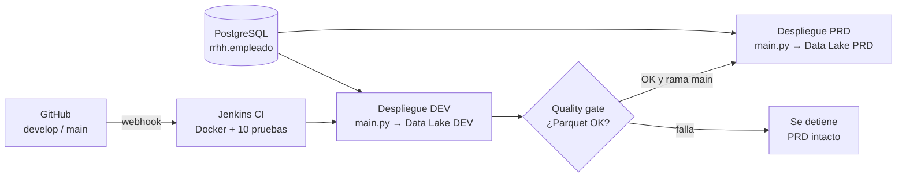

# Proyecto DataOps – Cálculo de comisiones

**Programa:** Data Engineer – DMC Institute · **Curso:** DataOps · **Profesor:** Miguelangel Garcia · **Alumna:** Lizeth Moreno

Pipeline automatizado que combina la tabla `dmc.rrhh.empleado` (PostgreSQL) con el archivo `ComisionEmpleados_V1_<periodo>.csv` almacenado en un Data Lake de Azure. Hace el join por `empleado_id`, calcula `salario_total = salario + comisión` y publica una tabla consolidada en **Parquet** (y Excel). El despliegue es automático con **CI/CD en Jenkins**, disparado por cada `git push` a GitHub, y pasa por **DEV → quality gate → PRD**.

> El enunciado permite la variante "Script Python" + "GitHub" + "Jenkins". Este proyecto usa esa variante y reutiliza la infraestructura vista en clase: la VM con Jenkins, las plantillas ARM y la nomenclatura `az-<INICIALES>-<amb>-de-...`.

## Contenido

1. [Arquitectura](#1-arquitectura)
2. [Estructura del repositorio](#2-estructura-del-repositorio)
3. [Resultados de las pruebas](#3-resultados-de-las-pruebas)
4. [Ejecución local (Windows + Git Bash + Docker)](#4-ejecución-local-windows--git-bash--docker)
5. [Despliegue en Azure y Jenkins](#5-despliegue-en-azure-y-jenkins)
6. [Flujo de trabajo con Git](#6-flujo-de-trabajo-con-git)
7. [Calidad de datos y decisiones de diseño](#7-calidad-de-datos-y-decisiones-de-diseño)
8. [Limpieza de recursos](#8-limpieza-de-recursos)

---

## 1. Arquitectura



Cada Data Lake se organiza en dos zonas:

```text
lake/
├── raw/comisiones/ComisionEmpleados_V1_202610.csv              ← entrada
└── curated/comisiones/periodo=202610/
    ├── comisiones_202610.parquet                               ← salida principal
    ├── comisiones_202610.xlsx
    └── _resumen.json                                           ← métricas de la corrida
```

| Etapa del Jenkinsfile | Tipo | Qué hace |
|---|---|---|
| 1. Preparar Entorno | CI | Valida Docker y Docker Compose en el agente |
| 2. Construir Imagen | CI | Construye la imagen Python con dependencias |
| 3. Pruebas Automáticas | CI | 10 pruebas pytest; publica el reporte JUnit |
| 4. Desplegar en DEV | CD | Ejecuta el pipeline contra el Data Lake DEV |
| 5. Quality Gate DEV | Aprobación automática | Relee el Parquet: filas, duplicados, nulos y cuadre de `salario_total` |
| 6. Desplegar en PRD | CD | Solo en rama `main` y si el gate aprobó; ejecuta y verifica en PRD |

## 2. Estructura del repositorio

```text
├── app/
│   ├── main.py            # Orquestación: CSV + BD → join → salario_total → Parquet/Excel
│   ├── etl.py             # Transformaciones puras (probadas con pytest)
│   ├── storage.py         # Acceso al Data Lake (modo azure) o a una carpeta (modo local)
│   ├── config.json        # Configuración SIN secretos
│   └── requirements.txt
├── data/
│   └── ComisionEmpleados_V1_202610.csv
├── tests/
│   ├── test_etl.py        # 10 pruebas automáticas (etapa CI)
│   ├── conftest.py
│   └── data/ComisionEmpleados_esquema_alterado.csv
├── infra/
│   ├── arm/datalake.json                    # Plantilla ARM del Data Lake
│   ├── arm/datalake.parameters.dev.json
│   ├── arm/datalake.parameters.prd.json
│   ├── 1_local_variables.example.txt
│   ├── 2_local_reemplazar_variables.sh      # (de clase) reemplaza <INICIALES>, <SUSCRIPCION>
│   ├── 3_desplegar_datalake.sh              # despliega ARM DEV/PRD y sube el CSV
│   ├── 5_eliminar_recursos.sh
│   └── deploy-vm-jenkins.sh                 # (de clase) VM Ubuntu + Docker + Jenkins
├── Dockerfile
├── docker-compose.yml
├── Jenkinsfile
├── .env.example
├── .gitignore
├── .gitattributes
└── README.md
```

## 3. Resultados de las pruebas

Pruebas ejecutadas en local con Docker contra la base de datos real del curso:

| # | Prueba | Resultado |
|---|---|---|
| 1 | Pruebas automáticas (`pytest`) | ✅ 10 passed en 0,36 s |
| 2 | Pipeline con CSV estándar, periodo 202610 | ✅ 34 filas CSV, 48 en BD, 33 consolidadas; Parquet y Excel generados |
| 3 | Quality gate (`--verificar`) | ✅ 33 filas, `salario_total` cuadra, sin duplicados ni nulos |
| 4 | CSV con esquema alterado (`ID Empleado` + BOM), periodo 202611 | ✅ Procesado sin error; suma de `salario_total` (436 905,20) idéntica a 202610 |
| 5 | Periodo sin archivo (202612) | ✅ Termina sin error: "No hay comisiones para 202612" |

Las pruebas sobre Azure y Jenkins (Data Lake DEV/PRD, webhook, Pull Request a `main`) se documentan en el informe final.

## 4. Ejecución local (Windows + Git Bash + Docker)

Requisitos: Git, Docker Desktop (con *Engine running*) y la contraseña de la base de datos del curso.

```bash
# 1. Preparar el "lake" local con el CSV
mkdir -p lake_local/raw/comisiones
cp data/ComisionEmpleados_V1_202610.csv lake_local/raw/comisiones/

# 2. Variables de entorno (el archivo .env no se sube a Git)
cp .env.example .env
notepad .env
```

En `.env`, escribe la contraseña **entre comillas simples**, porque tiene caracteres especiales:

```text
PG_PASSWORD='contraseña_del_curso'
```

```bash
# 3. Cargar variables, construir y ejecutar
set -a; source .env; set +a
docker compose build
docker compose run --rm -T app python -m pytest -v tests
docker compose run --rm -T app python main.py
docker compose run --rm -T app python main.py --verificar

# 4. Otro periodo (ej. el CSV con esquema alterado)
cp tests/data/ComisionEmpleados_esquema_alterado.csv lake_local/raw/comisiones/ComisionEmpleados_V1_202611.csv
docker compose run --rm -T -e PERIODO=202611 app python main.py
```

Notas para Git Bash:
- `-T` evita el error *"the input device is not a TTY"* de la terminal de Git Bash.
- Los contenedores se borran al terminar (`--rm`), por eso no aparecen en Docker Desktop. La imagen `comisiones-app` sí queda en **Images**.
- Si aparece una ruta del tipo `C:/Program Files/Git/...`, antepón `MSYS_NO_PATHCONV=1` al comando.

## 5. Despliegue en Azure y Jenkins

### 5.1 Data Lake DEV y PRD (plantillas ARM)

En [Azure Cloud Shell](https://shell.azure.com) (Bash), dentro de `infra/`:

```bash
cp 1_local_variables.example.txt 1_local_variables.txt   # edita INICIALES y SUSCRIPCION
bash 2_local_reemplazar_variables.sh
bash 3_desplegar_datalake.sh
```

El script crea por ambiente el grupo `az-<INICIALES>-<amb>-de-rg-dataops`, el Storage Account ADLS Gen2 `az<INICIALES><amb>dedlslake` con el contenedor `lake`, y sube el CSV a `lake/raw/comisiones/`. Al final muestra cómo obtener las cadenas de conexión.

### 5.2 VM con Jenkins

```bash
bash infra/deploy-vm-jenkins.sh
ssh azureuser@<IP_PUBLICA> 'sudo docker exec jenkins cat /var/jenkins_home/secrets/initialAdminPassword'
```

Si falla por cuota o región, cambia en el script `LOCATION` (`eastus`, `centralus`) o `VM_SIZE` (`Standard_B2s`).

### 5.3 Configurar Jenkins

1. Abre `http://<IP_PUBLICA>`, pega la clave, elige **Install suggested plugins** y crea tu usuario.
2. **Agente** (*Manage Jenkins → Nodes → New Node*):

   | Campo | Valor |
   |---|---|
   | Name / Labels | `azure_agent` (Permanent Agent) |
   | Executors | `2` |
   | Remote root directory | `/home/azureuser/jenkins` |
   | Launch method | *Launch agents via SSH* (plugin **SSH Build Agents**) |
   | Host | IP **privada** de la VM (`hostname -I`) |
   | Credentials | *Username with password*: `azureuser` / contraseña de la VM |
   | Host Key Verification | *Non verifying Verification Strategy* |

3. **Credenciales** (*Manage Jenkins → Credentials → Global*), todas de tipo **Secret text**:

   | ID | Valor |
   |---|---|
   | `pg-password` | Contraseña de la BD del curso |
   | `adls-dev-conn` | Cadena de conexión del Data Lake DEV |
   | `adls-prd-conn` | Cadena de conexión del Data Lake PRD |

4. **Job** (*New Item → `pipeline-comisiones` → Pipeline*):
   - *Triggers*: **GitHub hook trigger for GITScm polling**.
   - *Pipeline script from SCM* → Git → `https://github.com/jotikeng1/dataops-comisiones.git`.
   - *Branches to build*: `*/main` y `*/develop` · *Script Path*: `Jenkinsfile`.
   - Ejecuta una vez **Build with Parameters** para registrar el parámetro `PERIODO`.

### 5.4 Webhook en GitHub

*Settings → Webhooks → Add webhook*:
- **Payload URL**: `http://<IP_PUBLICA>/github-webhook/`
- **Content type**: `application/json`
- **Eventos**: *Just the push event*

## 6. Flujo de trabajo con Git

| Rama | Uso | Qué despliega Jenkins |
|---|---|---|
| `develop` | Trabajo diario; cada push | CI + DEV + quality gate |
| `main` | Producción; solo por Pull Request | CI + DEV + quality gate + PRD |

```bash
git checkout develop
# ... cambios ...
git add .
git commit -m "feat: descripción del cambio"
git push
# En GitHub: Pull Request develop → main → Merge
```

Los mensajes de commit siguen el formato `tipo: descripción` (`feat`, `fix`, `docs`, `test`, `ci`, `chore`).

## 7. Calidad de datos y decisiones de diseño

- **Cambio de esquema tolerado.** El CSV de la última sesión trae `ID Empleado` con BOM UTF-8 en vez de `empleado_id`. El código original fallaba con `KeyError`. `etl.normalizar_columnas` lo normaliza (prueba `test_tolera_esquema_alterado_con_bom`).
- **Validaciones del CSV.** Columnas requeridas, archivo no vacío, sin IDs nulos ni duplicados, comisión numérica y no negativa.
- **Empleados sin registro en BD.** El join es interno: el ID 4 del CSV no existe en `rrhh.empleado`, por lo que se excluye y se reporta como advertencia en el log y en `_resumen.json`.
- **Quality gate.** PRD solo se toca si el Parquet de DEV pasa la verificación automática.
- **Secretos fuera del repositorio.** Se gestionan con Jenkins Credentials; `.gitignore` excluye `.env` y variables locales.
- **Idempotencia.** Reprocesar un periodo sobrescribe su partición `periodo=AAAAMM` sin duplicar datos.

## 8. Limpieza de recursos

```bash
bash infra/5_eliminar_recursos.sh
az vm delete -g rg-lab-dataops-taller -n vm-jenkins-<INICIALES> --yes
```
